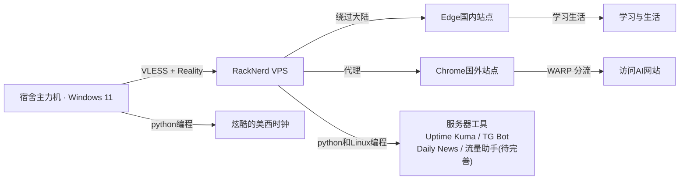

## 我的个人简介
> 大一 · 财务管理 · 自学技术 · 用 AI 把基建从零搭起来的人。
## 我是谁
你好，我是Yangmills-real，一位来自上海的**大一学生**，目前的专业是财管，十分热衷于前沿技术与有趣的程序。
以下是我的一些情况：
- 财务管理专业 2026 级
- 本人没学过计算机，Linux和python技术全靠自学 + AI 结对
- 主线：用 AI 学真本事 + 把基建搭好
## 基建展示

## 服务器运维与加固

为了把我二十美元一年的1核1G 的 RackNerd VPS 榨干，我做了以下基建：

- **零信任安全**：全程 Ed25519 密钥登录，禁用 root 及密码登录，SSH 端口改为 22022，从源头杜绝爆破。
- **网络防线**：部署 Fail2ban 自动拉黑恶意扫描 IP，搭配 UFW 防火墙精细化控制出入站流量。
- **代理伪装**：使用 `3x-ui` + `Xray` 手工搓出 `VLESS + Reality` 节点（伪装成Microsoft节点），备用 `Hysteria 2` 暴力推流。
- **智能分流**：利用 Cloudflare WARP 为特定 AI 站点做精准分流，避免 IP 被风控。
- **系统调优**：开启 BBR 拥塞控制调度，划出 2G Swap 防止内存 OOM 宕机，并配置系统自动安全更新。
- **监控告警**：自写 `check_traffic.sh` 配合 msmtp 实现每日 8/20 点流量邮件告警；部署 Uptime Kuma + Telegram Bot，实现宕机通知。
